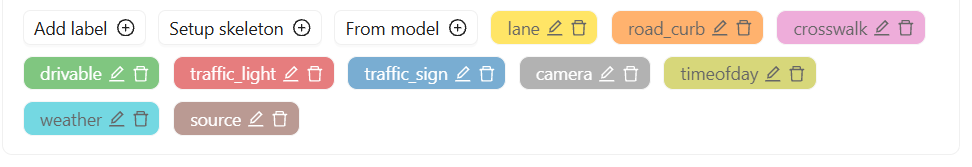
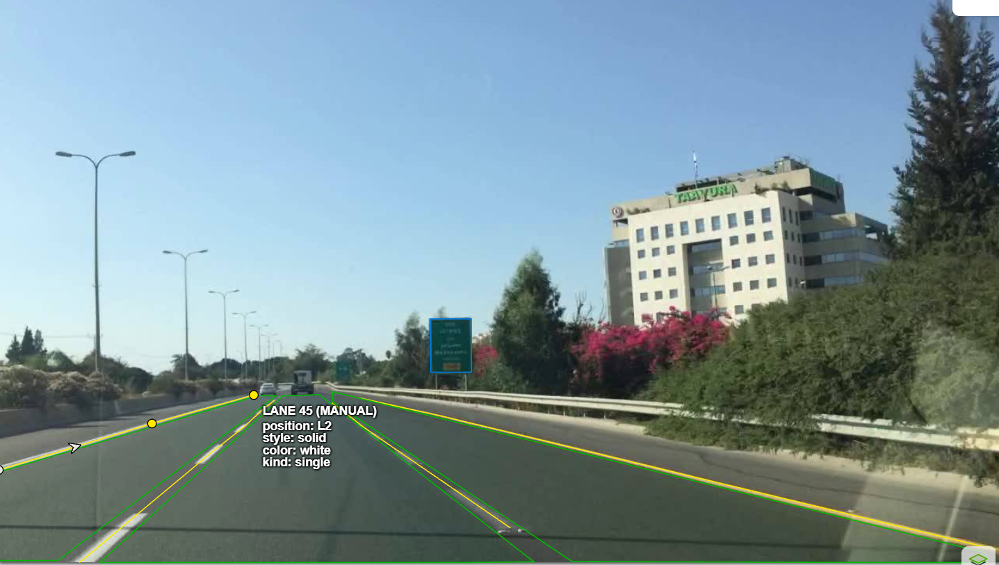
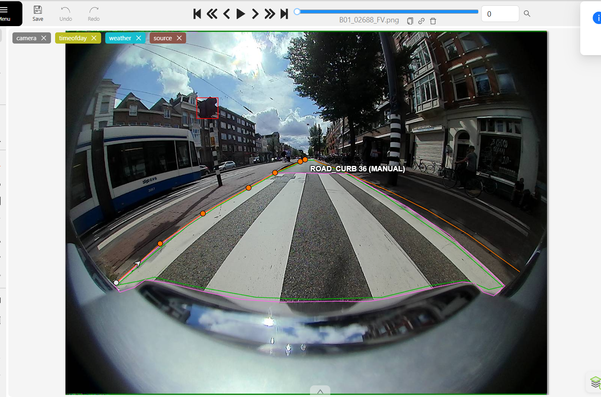
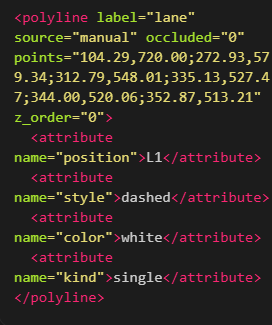

# Báo cáo cá nhân — Ngày 11
Họ tên: Phạm Đức Thọ               Mã học viên: 2a202603182  
Phiên bản CVAT (Help → About): v2.83.0 
Guideline: Road v1.0    Lần nộp (`revision` trong manifest): 2  
Thời điểm export (ngày giờ trên CVAT): 2026-11-21 01:37 (fisheye) · 2026-11-21 10:31 (front, revision 2)    Số lần nộp lại sau Rework: 1  

## 1. Kiểm project
| Mục | Đúng như guideline Road v1.0? | Ghi chú |
| --- | --- | --- |
| 6 label, đúng kiểu | Đúng | `lane` (polyline), `road_curb` (polyline), `crosswalk` (polygon), `drivable` (polygon), `traffic_light` (rectangle), `traffic_sign` (rectangle) — khớp `configs/road_v1_labels.json` |
| Thuộc tính và giá trị | Đúng | Đủ các thuộc tính `select` và `checkbox` (`edge_zone`) đúng danh sách giá trị Road v1.0 |
| 4 tag ảnh | Đúng | 4 label kiểu Tag (`camera`, `timeofday`, `weather`, `source`), mỗi label có 1 thuộc tính select `value` |

Cách kết thúc polyline trên bản CVAT này: Bấm phím **`N`** (hoặc bấm nút Done trên thanh công cụ).  
Cách đặt tag ảnh trên bản CVAT này: Chọn công cụ **Setup tag** ở thanh bên trái, chọn từng label tag (`camera` trước tiên, sau đó `timeofday`, `weather`, `source`), rồi mở **Details** trong bảng Objects để chọn đúng giá trị `value`.  

## 2. Số lượng đã gán
| Task | Ảnh | lane | road_curb | crosswalk | drivable | traffic_light | traffic_sign |
| --- | ---: | ---: | ---: | ---: | ---: | ---: | ---: |
| front | 12 | 29 | 4 | 4 | 26 | 21 | 19 |
| front-extra (đã làm 0 / 4) | 0 | 0 | 0 | 0 | 0 | 0 | 0 |
| fisheye | 8 | 11 | 9 | 7 | 10 | 5 | 2 |
| fisheye-extra (đã làm 0 / 4) | 0 | 0 | 0 | 0 | 0 | 0 | 0 |

## 3. Bảng ca khó
| Ảnh | Nhãn | Phân vân giữa | Đã chọn | Lý do |
| --- | --- | --- | --- | --- |
| A04 | `lane` | Vẽ 2 polyline song song hay 1 polyline cho vạch đôi | 1 polyline ở tâm vạch đôi, đặt `kind = double` | Theo guideline Road v1.0, vạch đôi chỉ vẽ một polyline duy nhất nằm giữa hai nét và biểu diễn bằng thuộc tính `kind = double` để tránh lỗi tách vạch (`QC1-05`). |
| A05 | `lane` (`L1`, `R1`) | Có nên vẽ vạch giả định hay bỏ trống khi `lint` báo `QC1-02` | Không vẽ `lane` (chỉ vẽ `drivable` ở lòng đường, không trùm lên 2 dải xe đỗ) | Đường khu công nghiệp hoàn toàn không có vạch kẻ sơn; guideline quy định không vẽ bịa vạch mà ảnh không có (`QC1-02` được miễn). |
| A06 | `lane` (`R1`) | Bên phải dưới gầm cầu chỉ có cột và bó vỉa, không có vạch sơn | Không vẽ `R1`, vẽ `road_curb` cho mép đường bên phải | Không có vạch sơn kẻ làn bên phải; mép đường không sơn được gán `road_curb` theo đúng mục 1 guideline. |
| A07 | `lane` (`L1`) | Bên trái làn xe là dải phân cách bê tông, không có vạch sơn | Không vẽ `L1`; vạch trắng giữa là `R1`, vạch bên phải sát xe tải là `R2` | Không có vạch sơn bên trái làn đang đi nên `QC1-02` (thiếu `L1`) được miễn theo CHECKPOINTS. |
| A09 | `lane` (`L1`/`L2`) & `drivable` | Xe đang đi ở làn phải sát `road_curb` hay làn trái giữa hai vạch | Giữ làn phải là `direct`, làn trái là `alternative`; vạch trắng đứt = `L1`, vạch trắng đôi = `L2`, mép phải = `road_curb` | Tâm ảnh ở `x = 640`, điểm tụ mặt đường ở `x ≈ 670`; vạch trắng đứt chạy xuống trái `(670,432) → (540,640)` nằm hoàn toàn bên trái tâm xe, còn mép bó vỉa chạy xuống phải `(763,421) → (1279,693)` nằm bên phải → xe chắc chắn ở làn phải và không có vạch sơn `R1` (miễn `QC1-02`). |
| B01 | `crosswalk` vs `lane` | 4 dải sơn trắng lớn trước đầu xe nhìn giống vạch làn hay vạch qua đường | Gán 1 polygon `crosswalk`, không vẽ `lane`, cắt gọn ở mép cản trước xe mình | Đây là vạch ngựa vạn bị kéo dài do méo ống kính fisheye; theo mục 4 guideline, vạch ngựa vạn gán `crosswalk`, không gán `lane`, và không trùm lên thân xe mình. |
| B03 | `lane` (`position` trên `fisheye_rear`) | Gán `L1`/`R1` theo khung ảnh hay theo hướng xe chạy khi nhìn camera sau | Vạch đứt liền mạch từ nét gần cản sau nhất, uốn cong theo cung fisheye, `style = dashed` | Camera sau nhìn ngược hướng xe; cần thống nhất một quy ước cho ảnh `RV` và nối liền vệt đứt sát xe nhất thành 1 polyline duy nhất để không mất điểm gần xe. |

## 4. Phiếu QC 1 nhận được
Bạn kiểm lô của tôi: Nguyễn Khánh Tùng (`2A202603144`)  Quyết định nhận được: Rework (`revision 1` → đã cất bản cũ vào `r1/` và nộp lại `revision 2`)  
| Mã lỗi | Số lỗi | Đồng ý? | Đã sửa? |
| --- | ---: | --- | --- |
| QC1-03 (`position`, nặng) | 3 | Đồng ý 1 lỗi (`A07 lane#1` gán nhầm `L1`); **Không đồng ý 2 lỗi trên `A09`** vì theo hình học phối cảnh (tâm xe `x = 640`, vạch đứt ở `x = 540` bên trái tâm xe, bó vỉa ở `x = 1279` bên phải) xe đang đi ở làn phải nên vạch đứt là `L1` và vạch đôi là `L2` | Đã sửa `A07 lane#1` từ `L1 → R2` (hết lỗi nặng thật) và export lại `phamductho-front.zip` (`revision 2`); giữ nguyên `A09` |
| QC1-06 (`style/color/kind`, chính) | 2 | Đồng ý (`A01` vạch mép phải `R2` màu vàng; vạch mép trái `L2` là vạch đôi) | Đã sửa `A01` `R2` sang `color = yellow` ở `revision 2` |
| QC1-09 (`group` biển báo, chính) | 3 | Đồng ý (`A01` biển xanh chỉ hướng = `information`; `A12` biển `ONE WAY` = `mandatory`, biển tên đường `Greene` = `information`) | Đã sửa `A01` sang `information` và cập nhật lại `A12` ở `revision 2` |
| QC1-07 (`drivable`, chính) | 5 | **Không đồng ý 2 lỗi trên `A09`** (cùng lý do phối cảnh làn phải là `direct`, làn trái là `alternative`); Đồng ý 3 lỗi còn lại (`A07`, `A12`, `B05`) | Đã chỉnh lại `A07` ở `revision 2`; giữ nguyên `A09` |

## 5. Kiểm file export
| File | Mở lại được? | Số shape ảnh 1 (job / file) | Số shape ảnh 2 (job / file) | Tag camera có trong XML? |
| --- | --- | --- | --- | --- |
| `phamductho-front.zip` | Có (`road_check lint` đọc thành công, `contains_images: false`) | 8 / 8 (`A01`) | 6 / 6 (`A02`) | Có (`camera=front`, đủ 12/12 ảnh) |
| `phamductho-fisheye.zip` | Có (`road_check lint` đọc thành công, `contains_images: false`) | 5 / 5 (`B01`) | 8 / 8 (`B02`) | Có (`fisheye_front/rear/left/right`, đủ 8/8 ảnh) |

## 6. Ảnh chụp màn hình
1. Tab Labels của project:

   

2. Một ảnh camera trước đã gán đủ (làn, vùng lái, đèn/biển — `A01`):

   

3. Một ảnh fisheye đã gán, phóng to đoạn polyline cong (`B01`):

   

4. Một đoạn XML có `<polyline label="lane">`:

   

## 7. Tự đánh giá
Lỗi bạn mắc nhiều nhất hôm nay (theo mã QC1-xx), và cách tránh ở Ngày 20:  
- Hai lỗi mắc nhiều nhất ban đầu (phát hiện khi chạy self-QC và `road_check lint`) là **`QC1-03`** (quên đổi `position = other` cho `lane` trên camera fisheye hai bên `MVL`/`MVR`, và để sót giá trị mặc định `L1` của CVAT trên ảnh front) và **`QC1-05`** (vẽ vạch đôi thành 2 polyline riêng thay vì 1 polyline với `kind = double`).  
- Cách tránh ở Ngày 20: hình thành thói quen **mở bảng Details sửa thuộc tính ngay sau khi vẽ xong từng hình** (không để cuối ảnh mới sửa), kiểm tra kỹ danh sách Objects cho các ảnh camera hai bên, và luôn chạy `road_check lint` ngay sau khi export để rà lỗi hệ thống trước khi bàn giao.

Nhãn của bạn đi vào model ở đâu? Chọn một lỗi đã sửa và nói nó làm model học sai thế nào:  
- Nhãn `lane` (polyline) đi vào bài toán **phát hiện làn đường (Lane Detection / Row-Anchor)** phục vụ chức năng **giữ làn đường (LKA — Lane Keeping Assist)**; nhãn `drivable` đi vào bài toán **phân vùng mặt đường lái được**; nhãn `traffic_light`/`traffic_sign` đi vào bài toán **phát hiện đèn tín hiệu & biển báo**; còn nhãn fisheye đi vào hệ thống **quan sát xung quanh (SVM — Surround View Monitoring)**.  
- Ví dụ lỗi đã sửa: **`QC1-03` (gán nhầm `position = R1/L1` trên camera hai bên `B06–B08` thay vì `other`)** và **`QC1-04` (vẽ ngược chiều polyline từ xa về gần trên `A04`)**. Nếu lỗi sai `position` đi vào tập huấn luyện, bộ phân loại làn của model sẽ nhận nhầm vạch đường ở bên hông xe thành vạch giới hạn làn xe đang chạy (`L1`/`R1`), khiến hệ thống LKA ước lượng sai tâm làn và đánh lái lệch. Tương tự, polyline vẽ ngược chiều hoặc thiếu đoạn đầu gần xe sẽ làm sai toạ độ các hàng neo (row-anchor) sát đầu xe — vùng có trọng số điều khiển LKA cao nhất.

## 8. (Tùy chọn, buffer) Từ polyline đến đích row-anchor
*(Không tính điểm — chỉ điền nếu thực hiện hoạt động buffer với `road_lab.rowanchor`)*
| y | 720 | 680 | 640 | 600 | 560 |
| --- | ---: | ---: | ---: | ---: | ---: |
| x của chúng tôi | | | | | |
| x của bạn kia | | | | | |
